### Vinamr Jain

PhD student at Cornell, advised by [Sarah Dean](https://sdean.website/) and [Alexander Terenin](https://avt.im/). I work on decision-making under (un)certainty: how should an agent act when it doesn't even know what the rules are?

  <a href="https://vinamr.dev/papers/decision-making-unknown-dynamics/">
    <picture>
      <source media="(prefers-color-scheme: dark)" srcset="assets/globe-dark.svg">
      
    </picture>
  </a>

Real winds (ERA5 reanalysis, September 2017). The route is an illustration, computed with the wind known.

- 🌐 **[vinamr.dev](https://vinamr.dev)** · papers, things I build, essays. Every paper comes with a version explained to a five-year-old.
- 🎈 **[zermelo](https://github.com/VinamrJain/zermelo)** · a JAX simulation environment for autonomous navigation of balloons and boats and stuff. Ongoing.
- 🎲 **[Thompson Sampling using Prior-fitted Diffusion Transformers](https://vinamr.dev/papers/pfn-thompson-sampling/)** · NeurIPS 2026.

[Google Scholar](https://scholar.google.com/citations?user=bMstrTwAAAAJ&hl=en) · [LinkedIn](https://www.linkedin.com/in/vinamr-jain/) · [CV](https://vinamr.dev)
